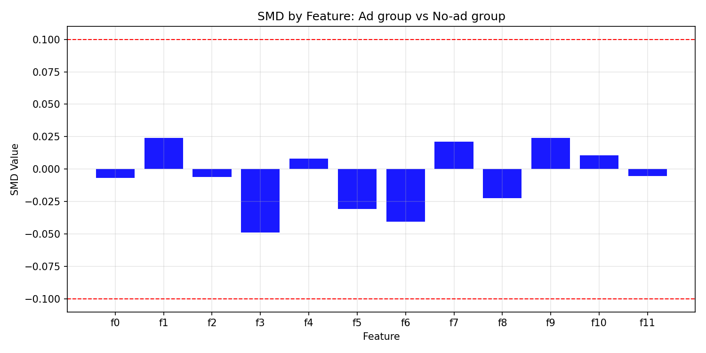

# uplift-benchmark

Exploratory analysis of the **Criteo Uplift Prediction dataset (v2.1)**, a step toward benchmarking uplift models. The goal is to measure how much showing an ad changes user behaviour (visits and conversions), not just who is likely to convert.

> **Status:** early exploration. Data prep, feature distributions, a covariate-balance check and average treatment effects are done. No uplift models have been built yet.

## Dataset

[Criteo Uplift Prediction Dataset v2.1](https://ailab.criteo.com/criteo-uplift-prediction-dataset/) (Diemert et al., 2018, *A Large Scale Benchmark for Uplift Modeling*).

- **13,979,592 rows**, one per user, from randomized incrementality tests.
- **85% ad group / 15% no-ad group** (11.88M vs 2.10M users).

| Column | Type | Meaning |
|---|---|---|
| `f0` … `f11` | float | Anonymized user features (projected, so values have no direct business meaning) |
| `treatment` | 0/1 | 1 = user was assigned to the ad group, 0 = no-ad group |
| `exposure` | 0/1 | 1 = user was actually shown an ad |
| `visit` | 0/1 | 1 = user visited the advertiser's site |
| `conversion` | 0/1 | 1 = user converted |

## Project structure

```
uplift-benchmark/
├── data/
│   ├── raw/            # criteo-uplift-v2.1.csv (not tracked by git)
│   └── processed/      # cleaned parquet written by the script (not tracked)
├── figures/            # saved charts
├── notebooks/
│   └── main.py         # end-to-end analysis script
├── src/                # reusable code (empty for now)
├── DECISIONS.md        # log of analysis decisions
└── requirements.txt
```

## Setup

Tested with Python 3.9.

```bash
git clone https://github.com/bharathraahul/uplift-benchmark.git
cd uplift-benchmark
python -m venv .venv
source .venv/bin/activate
pip install -r requirements.txt
```

Download the dataset (about 311 MB compressed, 3.2 GB unzipped) from the Criteo page linked above into `data/raw/`, then unzip it. The script reads the uncompressed CSV:

```bash
gunzip -k data/raw/criteo-uplift-v2.1.csv.gz
```

## Running

Run from the repository root, because the script uses relative paths:

```bash
python notebooks/main.py
```

The script:

1. Loads the raw CSV, drops missing rows, and saves `data/processed/criteo-uplift-v2.1.parquet`.
2. Casts columns to smaller types (`float32` features, `int8`/`int16` flags) and shuffles the rows.
3. Plots each feature's sorted values (quantile curves) and compares f0 between the ad and no-ad groups.
4. Checks covariate balance with the standardized mean difference (SMD) and saves `figures/smd_balance.png`.
5. Prints average treatment effects (ATE) for visit, conversion and exposure.

Each chart opens in a window; close it to continue to the next step. Loading the full CSV takes several minutes and needs a few GB of RAM.

## Findings so far

### Feature distributions

Most features are dominated by a single repeated value. In 8 of the 12 features, roughly 80–99% of rows share one value, which most likely corresponds to "no activity" before anonymization. f0 has about 27% of rows at its minimum. f1 and f11 are almost constant (about 99%) and carry little information.

### Covariate balance



Every feature has |SMD| < 0.1, the usual balance threshold. The largest are f3 (−0.049) and f6 (−0.040). Randomization holds, so no reweighting is needed before estimating effects. See [DECISIONS.md](DECISIONS.md).

### Average treatment effects

Difference in means between the ad and no-ad groups, with 95% confidence intervals:

| Outcome | Ad group | No-ad group | ATE | 95% CI | Relative lift |
|---|---|---|---|---|---|
| Visit | 4.854% | 3.820% | +1.03 pp | [1.01, 1.06] pp | +27% |
| Conversion | 0.309% | 0.194% | +0.115 pp | [0.108, 0.122] pp | +59% |

These are **intent-to-treat** effects. They compare users *assigned* to the ad group with users who weren't, regardless of whether an ad was shown. Only **3.6%** of the ad group was actually exposed, and nobody in the no-ad group was. The effect on users who actually saw an ad is therefore much larger than the numbers above.

## Decisions log

Analysis choices and the reasoning behind them are recorded in [DECISIONS.md](DECISIONS.md).

## License

[MIT](LICENSE) © 2026 Bharath Raahul M
