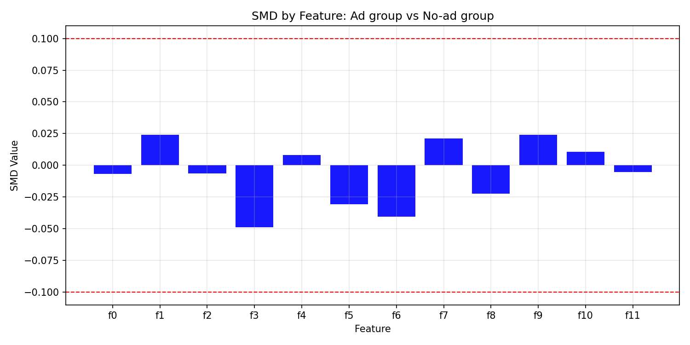

# uplift-benchmark

Exploratory analysis of the **Criteo Uplift Prediction dataset (v2.1)**, a step toward benchmarking uplift models. The goal is to measure how much showing an ad changes user behaviour (visits and conversions), not just who is likely to convert.

> **Status:** data prep, a covariate-balance check, average treatment effects and a train/validation/test split are done. Baseline uplift models (T-learner and S-learner) are fit; evaluating them on validation is next.

## Dataset

[Criteo Uplift Prediction Dataset v2.1](https://ailab.criteo.com/criteo-uplift-prediction-dataset/) (Diemert et al., 2018, *A Large Scale Benchmark for Uplift Modeling*).

- **13,979,592 rows**, one per user, from randomized incrementality tests.
- **85% ad group / 15% no-ad group** (11.88M vs 2.10M users).

| Column | Type | Meaning |
|---|---|---|
| `f0` … `f11` | float | Anonymized user features (projected, so values have no direct business meaning) |
| `treatment` | 0/1 | 1 = user was assigned to the ad group, 0 = no-ad group |
| `exposure` | 0/1 | 1 = user was actually shown an ad |
| `visit` | 0/1 | 1 = user visited the advertiser's site |
| `conversion` | 0/1 | 1 = user converted |

The data prep notebook adds two columns to the Parquet:

| Column | Type | Meaning |
|---|---|---|
| `split` | train / validation / test | 60/20/20 split, with the same treatment and conversion mix in each |
| `dev` | bool | True for a 1.5M-row sample of train, used for quick experiments |

## Project structure

```
uplift-benchmark/
├── data/
│   ├── raw/                      # criteo-uplift-v2.1.csv (not tracked by git)
│   └── processed/                # Parquet with split and dev columns (not tracked)
├── figures/                      # saved charts and the results table
├── notebooks/
│   ├── 01_data_prep.ipynb        # builds the Parquet, makes the split and dev sample
│   ├── 02_audit.ipynb            # feature distributions, covariate balance, exposure
│   ├── 03_ate.ipynb              # average treatment effects and robustness checks
│   ├── 04_uplift_baselines.ipynb # T-learner and S-learner uplift models
│   └── main.py                   # original all-in-one script (audit + ATE, no split)
├── src/
│   └── effects.py                # smd() and ate() used by the notebooks
├── DECISIONS.md                  # log of analysis decisions
└── requirements.txt
```

## Setup

Tested with Python 3.9.

```bash
git clone https://github.com/bharathraahul/uplift-benchmark.git
cd uplift-benchmark
python -m venv .venv
source .venv/bin/activate
pip install -r requirements.txt
```

Download the dataset (about 311 MB compressed, 3.2 GB unzipped) from the Criteo page linked above into `data/raw/`, then unzip it. The data prep notebook reads the uncompressed CSV:

```bash
gunzip -k data/raw/criteo-uplift-v2.1.csv.gz
```

## Running

Run the notebooks in order from the `notebooks/` folder (their paths start with `../`):

1. **`01_data_prep.ipynb`**: on the first run only, reads the raw CSV, drops missing rows, casts columns to smaller types (`float32` features, `int8`/`int16` flags) and saves `data/processed/criteo-uplift-v2.1.parquet` (about 158 MB on disk). It then adds the `split` and `dev` columns and prints a check that every split has the same treatment share and outcome rates. To rebuild everything, delete the Parquet file.
2. **`02_audit.ipynb`**: plots each feature's sorted values, checks covariate balance with the standardized mean difference (SMD), saves `figures/smd_balance.png` and checks exposure.
3. **`03_ate.ipynb`**: average treatment effects for visit and conversion, a bootstrap CI, a covariate-adjusted ATE, and `figures/phase2_results.csv`.
4. **`04_uplift_baselines.ipynb`**: fits T-learner and S-learner models on the dev sample and scores validation users. Loads train and validation only.

`main.py` is the original script covering steps 2 and 3. It uses root-relative paths, so run it from the repository root with `python notebooks/main.py`.

### Test set rule

The test split is locked until the final evaluation. After the split check in `01_data_prep.ipynb`, every notebook loads data without it:

```python
pd.read_parquet(parquet_path, filters=[('split', '!=', 'test')])
```

## Findings so far

### Feature distributions

Most features are dominated by a single repeated value. In 8 of the 12 features, roughly 80–99% of rows share one value, which most likely corresponds to "no activity" before anonymization. f0 has about 27% of rows at its minimum. f1 and f11 are almost constant (about 99%) and carry little information.

### Covariate balance



Every feature has |SMD| < 0.1, the usual balance threshold. The largest are f3 (−0.049) and f6 (−0.040). Randomization holds, so no reweighting is needed before estimating effects. See [DECISIONS.md](DECISIONS.md).

### Average treatment effects

Difference in means between the ad and no-ad groups, with 95% confidence intervals:

| Outcome | Ad group | No-ad group | ATE | 95% CI | Relative lift |
|---|---|---|---|---|---|
| Visit | 4.854% | 3.820% | +1.03 pp | [1.01, 1.06] pp | +27% |
| Conversion | 0.309% | 0.194% | +0.115 pp | [0.108, 0.122] pp | +59% |

These are **intent-to-treat** effects. They compare users *assigned* to the ad group with users who weren't, regardless of whether an ad was shown. Only **3.6%** of the ad group was actually exposed, and nobody in the no-ad group was. The effect on users who actually saw an ad is therefore much larger than the numbers above.

### Primary outcome

**Visit** is the primary modeling target and conversion is secondary. Conversion is too rare for reliable uplift estimates: the test split has only 813 no-ad conversions, against 15,982 no-ad visits. See [DECISIONS.md](DECISIONS.md).

### Baseline uplift models

`04_uplift_baselines.ipynb` fits two standard uplift models with LightGBM on the 1.5M-row dev sample, with visit as the target:

- **T-learner**: one model for the ad group and one for the no-ad group. Predicted uplift is the difference between them.
- **S-learner**: one model with `treatment` as a feature. Predicted uplift is its prediction with treatment = 1 minus treatment = 0.
- **Random scores**, as the baseline to beat.

The models are not evaluated yet. Next is ranking quality on validation (Qini and uplift curves).

## Decisions log

Analysis choices and the reasoning behind them are recorded in [DECISIONS.md](DECISIONS.md).

## License

[MIT](LICENSE) © 2026 Bharath Raahul M
